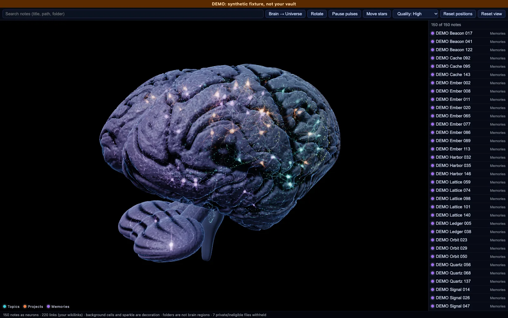
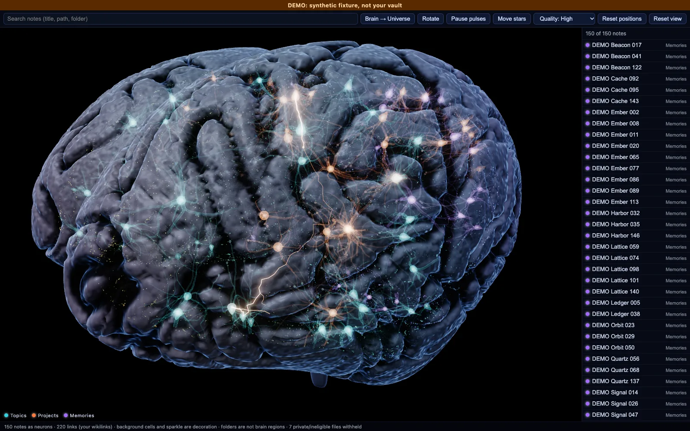
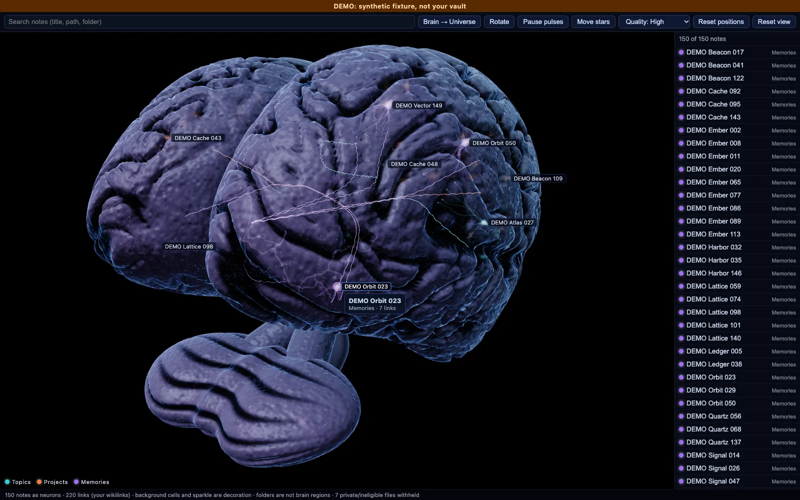

# Palace Atlas

A model-neutral second brain for your AI tools, made of plain markdown notes you own.

- **Memory** – a small MCP server and CLI (`palace-memory`) that lets any MCP-capable AI read your notes and, only if you allow it, add new ones to a folder you choose.
- **Atlas** – an Obsidian plugin that draws the same notes and links as a 3D brain: one neuron per note, one line per real link.
- **Plain files** – everything lives in your vault as `.md`. No database, no cloud, no account. Nothing leaves your machine.

The brain is a procedural illustration (generated from math and noise, not scans). It is not anatomical and does not depict anyone's brain.

## Try it in 60 seconds (no vault, no install)

The demo runs on a **synthetic** vault, so nothing of yours is involved.

1. Download `palace-atlas-demo-<version>.zip` from the [Releases page](https://github.com/afahmi1/palace-atlas/releases) and unzip it. *(Or build it yourself: see [Build from source](#build-from-source).)*
2. Needs [Node.js 20.3+](https://nodejs.org/). In the unzipped folder run:
   ```sh
   node serve.mjs
   ```
3. Open <http://127.0.0.1:4173/?asset=assets>.

The server binds to `127.0.0.1` only. (Browsers refuse to load the 3D assets from `file://`, which is why a tiny local server is needed.)

## Install the Obsidian plugin

Desktop Obsidian 1.4.0 or newer.

1. Download `palace-atlas-<version>.zip` from the [Releases page](https://github.com/afahmi1/palace-atlas/releases) and unzip it. You get one folder, `palace-atlas/`.
2. Move that folder to `<your vault>/.obsidian/plugins/palace-atlas/`. (`.obsidian` is hidden: use Cmd+Shift+. on macOS, "Hidden items" on Windows.) The file `main.js` must sit directly inside it.
3. In Obsidian: **Settings → Community plugins →** turn off Restricted mode **→** enable **Palace Atlas**.
4. Click the brain icon in the left ribbon, or run **Open Palace Atlas** from the command palette.

By default the Atlas shows notes under three top-level vault folders: `topics`, `projects`, `memories`. To change that, add a `palace-atlas.json` at the vault root. Hidden paths and notes marked `private: true` are never shown.

Upgrading, rollback and the one-command installer: [docs/install.md](docs/install.md). Uninstall: delete the plugin folder.

## Connect an AI (MCP / CLI)

The memory server is a single self-contained file, `palace-atlas-memory-<version>.cjs` on the [Releases page](https://github.com/afahmi1/palace-atlas/releases) (ship it with the `LICENSE` and `NOTICES.md` next to it), or `memory/dist/palace-memory.cjs` after a build. It runs on Node 20.3+. [docs/connect.md](docs/connect.md) documents the CLI, the read/write permission model, and config for **Claude Desktop** and **Claude Code**.

## Gallery

All screenshots are real captures of this build running the synthetic demo vault (150 generated notes, 220 links). How they were made and how to regenerate them: [docs/gallery.md](docs/gallery.md).



*The Atlas in the demo. Each glowing point is one note, coloured by folder (topics, projects, memories); the list on the right is the same set of notes. The brain is a procedural illustration, not anatomy.*



*Links as lightning. Every bolt follows a real link between two notes, from one note's axon to the other's dendrite. Background sparkle is decoration only. For this capture one link strike was fired by a deterministic demo trigger and frozen at its return stroke; in normal use strikes fire on their own.*



*Selecting a note. Hovering a note highlights it, shows its title and link count, and labels the notes it connects to.*

## Build from source

```sh
git clone https://github.com/afahmi1/palace-atlas.git && cd palace-atlas
npm ci
npm run build          # plugin: main.js + dist-demo/
npm run build:memory   # memory server + CLI: memory/dist/
npm run demo           # build + serve the synthetic demo at http://127.0.0.1:4173/?asset=assets
npm run package        # release/ with the plugin zip, demo zip, memory file and SHA256SUMS
```

Tests, the full release gate, CI and how a release is made: [docs/development.md](docs/development.md).

## Privacy

- The plugin is read-only toward your notes. It writes only its own settings (`data.json`) and a counts-only `diag.json` in its plugin folder, never note titles, paths or text.
- The memory server reads only the folders in your scope config and writes only when you enable it, only to the inbox folder.
- No network access is needed to run either part.

## License

[MIT](LICENSE). Third-party code bundled in the release files (three.js, three-mesh-bvh, the MCP TypeScript SDK, zod) keeps its own license; the full texts are in [NOTICES.md](NOTICES.md). The brain meshes, signed-distance field and neuron shapes are original, generated by the scripts in `scripts/` and `src/morph.ts`.
