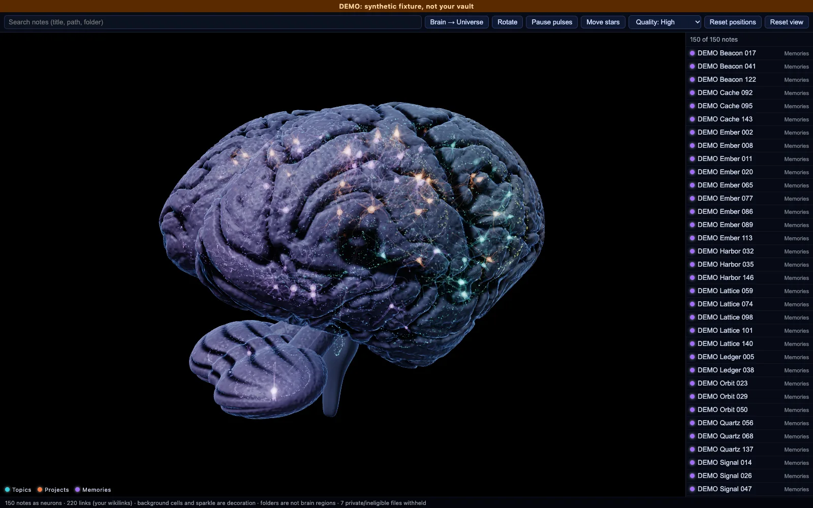
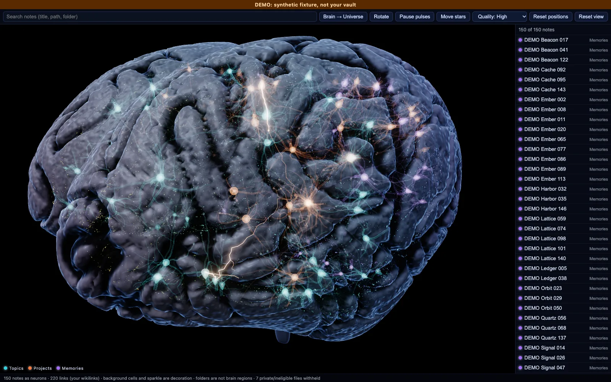
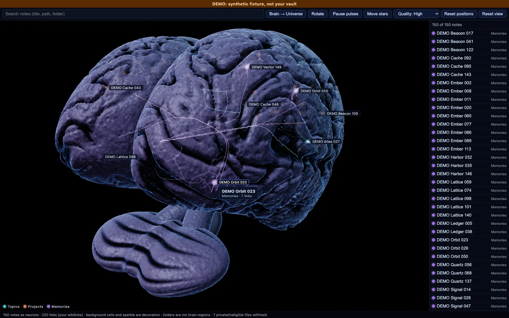

# Gallery

All images show the **synthetic demo fixture** (150 generated `DEMO …` notes; see `demo/fixture.ts`). They are not from a real vault.
They were rendered in headless Chrome on the GPU at 1600×1000, Quality: High, using the bundled original procedural assets
(`assets/brain.glb`, `assets/brain_sdf.bin`, `assets/morphologies.json`). To regenerate them:

```sh
npm run build && node test/capture-gallery.mjs   # writes docs/images/*.webp
```

## Whole brain with cerebellum



*Brain view, left posterior three-quarter angle. Each glowing neuron is one note, coloured by folder. The cerebellum and brainstem are part of the same original procedural mesh.*

## Lightning along a real link



*One link discharge, triggered on purpose and frozen at the return stroke (leader, then a bright main channel with forks). Link bolts follow real wikilinks between notes and stay inside the brain's distance field.*

## Selected note and its links



*Hovering or selecting a note keeps it and its real linked neighbours lit and labelled, and dims the rest. The tooltip shows the folder and the link count.*
